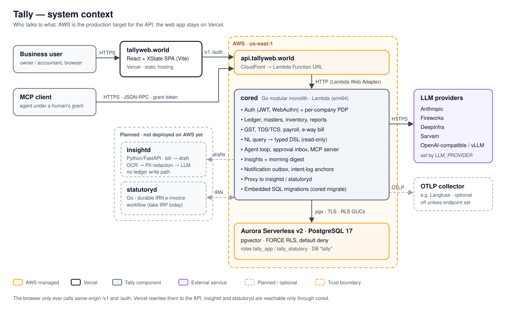
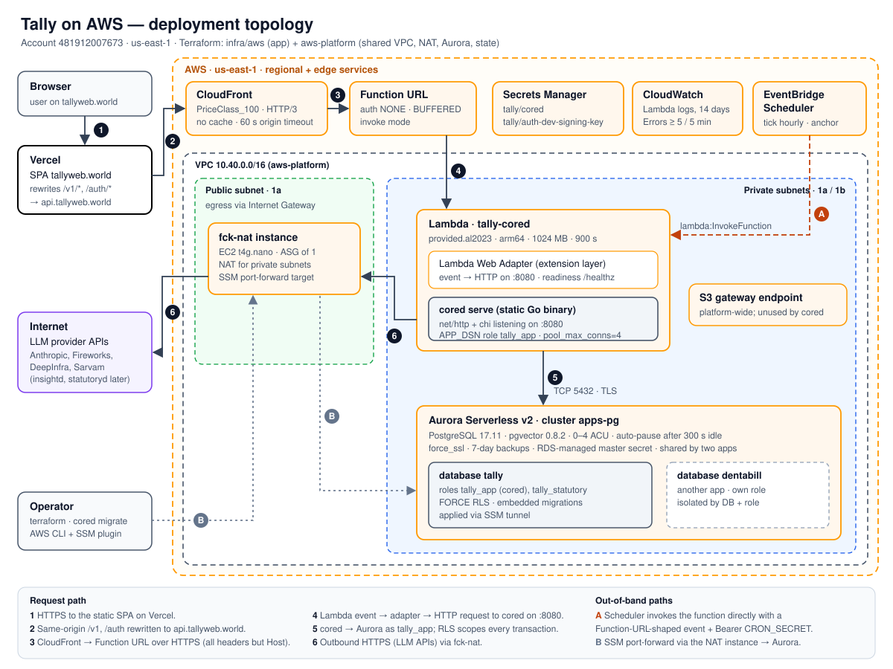
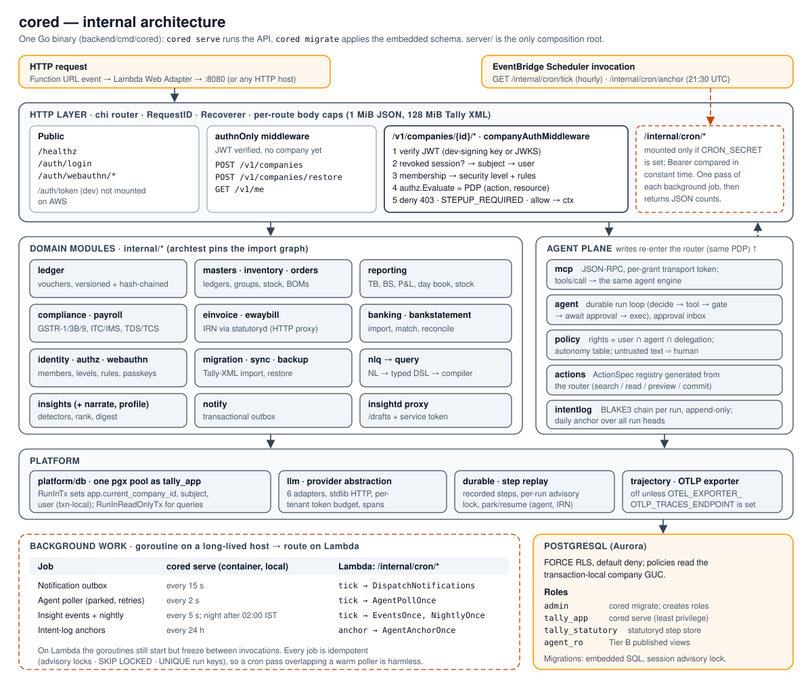
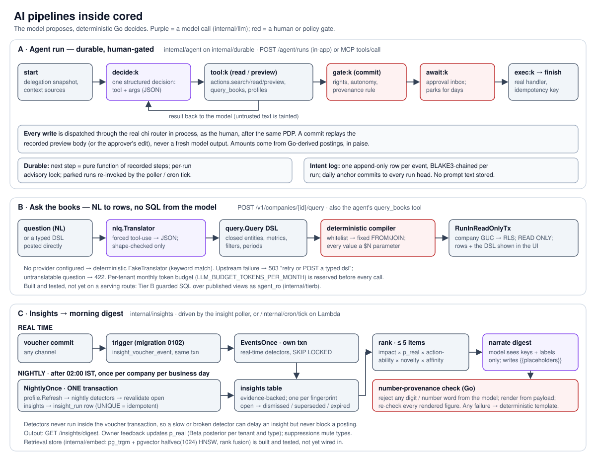

<p align="center">
  <a href="https://tallyweb.world/">
    
  </a>
</p>

<h1 align="center">Familiar keys. A new chapter.</h1>

<p align="center">Keyboard-first accounting, inventory, and AI-assisted workflows — in your browser.</p>

<p align="center">
  <a href="https://tallyweb.world/">Website</a> ·
  <a href="https://tallyweb.world/signin">Sign in</a> ·
  <a href="#architecture">Architecture</a> ·
  <a href="#getting-started">Getting started</a> ·
  <a href="DESIGN.md">Design system</a>
</p>

## What is Tallyweb?

Tallyweb is an accounting and ERP application for Indian businesses and their accountants. It combines familiar Tally-style keyboard navigation with a browser-based workspace and tools that help turn business documents into reviewable accounting work.

- **Accounting:** sales, purchases, receipts, payments, ledgers, and versioned vouchers.
- **Reports:** Day Book, Balance Sheet, Profit & Loss, outstanding balances, and drill-down reports.
- **Inventory:** stock summaries, stock movements, sales and purchase orders, and bills of materials.
- **Banking and tax workflows:** bank statement imports, reconciliation, GST reports, and TDS workflows.
- **AI assistance:** bill-to-draft processing, questions about your books, insights, and an Approval Inbox for agent proposals.
- **Business controls:** company-scoped access, roles and permissions, voucher edit history, and an offline outbox for queued entries.

Capabilities depend on service configuration. AI providers, OCR, and statutory integrations require their own setup; the repository does not imply live filing or production certification. See the [AWS runbook](infra/aws/README.md), the [legacy Vercel deployment guide](docs/DEPLOY_VERCEL.md) and the [service documentation](insightd/README.md) for limitations.

## Architecture

### Context and goals

Tally is a single-tenant-per-company, multi-company accounting system. The design has to hold four properties at once:

1. **The books are never wrong silently.** Double entry, versioned and hash-chained vouchers, and tenant isolation are enforced in Postgres (FORCE RLS), not just in handlers.
2. **AI proposes, Go decides.** No model writes SQL against base tables, computes money, or commits a write without a gate. Every agent write goes through the same router and policy decision point (PDP) a human's keystroke does.
3. **One deployable that runs anywhere.** `cored` is an ordinary `net/http` server, so the same binary runs locally, in a container, and on Lambda.
4. **Near-zero idle cost.** Traffic is bursty and low, so idle time should cost almost nothing. The AWS deployment scales compute and database to zero.



### Components

| Component | Code | Responsibility | Runs on (production) |
|---|---|---|---|
| Web app | `frontend/` (React, XState, Vite) | Keyboard-first workspace and public pages. Calls only same-origin `/v1` and `/auth`. | Vercel, `tallyweb.world`. `vercel.json` rewrites `/v1/*` and `/auth/*` to `api.tallyweb.world`. |
| **cored** | `backend/cmd/cored`, `backend/internal/*` | System of record and the only door to it: auth, PDP, ledger, masters, inventory, reports, GST, TDS/TCS, payroll, NL query, agent plane, MCP server, insights, notification outbox, and embedded migrations. | AWS Lambda behind CloudFront |
| Postgres | `backend/migrations` (embedded SQL) | All state. FORCE RLS with default deny. pgvector backs the retrieval store. | Aurora Serverless v2, PostgreSQL 17, database `tally` |
| insightd | `insightd/` (Python, FastAPI) | Turns a bill (image or PDF) into a `PurchaseVoucherDraft`: OCR, then PII redaction, then LLM. It has no ledger write path and is reached only through cored's `/drafts` proxy. | **Not deployed yet.** |
| statutoryd | `backend/cmd/statutoryd` | Durable IRN (e-invoice) workflow. It calls back into cored's freeze hook as `svc:statutoryd` and uses the `tally_statutory` role. Today it uses a fake IRP provider. | **Not deployed yet.** |
| LLM providers | `backend/internal/llm` | One stdlib-only client with six adapters (Anthropic, Fireworks, DeepInfra, Sarvam, OpenAI-compatible, vLLM), a per-tenant token budget, and trajectory spans. | External HTTPS through the NAT instance |

### Deployment on AWS



AWS account `481912007673`, region `us-east-1`. The app stack is [`infra/aws/main.tf`](infra/aws/main.tf). Shared pieces live in the separate `aws-platform` repo and are read here through `terraform_remote_state`: the VPC `10.40.0.0/16`, the fck-nat instance, the Aurora cluster `apps-pg`, the state bucket, and GitHub OIDC. The same Aurora cluster also hosts DentaBill, with its own database and role.

| Layer | Resource | Key settings |
|---|---|---|
| Edge | CloudFront `api.tallyweb.world` (distribution `EU249Y89T83CV`, `d3178wtdimyukv.cloudfront.net`) | PriceClass_100, HTTP/3, caching disabled, `AllViewerExceptHostHeader`, 60 s origin read timeout |
| Compute | Lambda `tally-cored` behind a Function URL (`BUFFERED`) | `provided.al2023` arm64, 1024 MB, 900 s. A static Go binary is started by `bootstrap`. Lambda Web Adapter layer proxies to `:8080` with readiness on `/healthz` and async init. Runs in private subnets. |
| Data | Aurora Serverless v2 `apps-pg` | PostgreSQL 17.11, pgvector 0.8.2, 0–4 ACU, auto-pause after 300 s, `force_ssl`, 7-day backups, RDS-managed master secret |
| Network | fck-nat `t4g.nano` (ASG of 1), S3 gateway endpoint | NAT for Lambda egress, and the SSM port-forward target for operators |
| Schedules | EventBridge Scheduler | `/internal/cron/tick` hourly, `/internal/cron/anchor` at 21:30 UTC (03:00 IST) |
| Secrets | Secrets Manager `tally/cored`, `tally/auth-dev-signing-key` | Role passwords, `CRON_SECRET`, and the ed25519 signing key, injected as env vars at `terraform apply` |
| Ops | CloudWatch, SNS | Log group with 14-day retention. `Errors` alarm `tally-cored-errors` at ≥ 5 per 5 min, notifying the shared `apps-alerts` SNS topic. |

### Request and data flow

1. The browser loads the SPA from Vercel. API calls go to the same origin (`/v1/...`), so there is no CORS. Vercel rewrites them to `api.tallyweb.world`.
2. CloudFront forwards everything except `Host` to the Function URL, without caching.
3. The Lambda Web Adapter turns the invocation into an HTTP request to `cored serve` on `:8080`.
4. The chi router runs `companyAuthMiddleware` on `/v1/companies/{id}/*`: verify the JWT, reject revoked sessions, resolve the user and membership, then load the security level and rules and call `authz.Evaluate` (the PDP). The handler runs only if the PDP allows the request.
5. Each handler opens a transaction on the single `tally_app` pool. `RunInTx` sets `app.current_company_id`, the subject, and the user as **transaction-local** settings, and RLS scopes every statement to them. Reads from NL queries go through `RunInReadOnlyTx`.
6. LLM calls (NL to DSL, agent decisions, digest narration) leave through the NAT instance. The AI pipelines and their guardrails are covered below.





### Key design decisions

| Decision | Why | Trade-off accepted |
|---|---|---|
| **Lambda Web Adapter** instead of a Lambda handler | `cored` stays a normal `net/http` and chi server. The same binary runs locally, in a container, and on Lambda, with no AWS SDK in the app. | An extension layer is in the cold path. Responses are buffered, so there is no streaming. |
| **Zip on `provided.al2023` arm64** | A static Go binary needs no Docker or ECR. Builds are small and fast, and arm64 costs less. | You must cross-compile (`infra/aws/build.sh`). Native dependencies are not an option. |
| **CloudFront + Function URL**, not API Gateway | API Gateway HTTP APIs cut requests at 30 s, and cored allows 60 s LLM calls. CloudFront also provides the custom domain and TLS. | The Function URL is `auth NONE` and publicly reachable (see Failure modes). OAC was rejected because it requires clients to sign POST bodies. |
| **Scheduler invokes the function directly** | The scheduler sends a Function-URL-shaped event with `Bearer CRON_SECRET`. This bypasses CloudFront's 60 s limit, so the nightly pass gets the full 900 s. | The event shape is hand-written in Terraform and coupled to the adapter's payload v2 parsing. |
| **Hourly tick**, not every minute | Each tick wakes Aurora. With hourly ticks the database can pause between runs. | Background latency is up to 1 h when nobody is online. Warm instances still run in-process pollers. |
| **fck-nat** instead of NAT Gateway | About $7 a month instead of about $33. | Single AZ and a single instance. The ASG replaces it on failure, and egress is down until it does. |
| **RLS roles** `tally_app` / `tally_statutory` (plus `agent_ro` for Tier B views) | Least privilege, and NOBYPASSRLS on serving roles. Tenant isolation holds even if a handler forgets a `WHERE`. | Every query must run inside a GUC-scoped transaction, and the pool size is per instance. |
| **Embedded migrations run through an SSM tunnel** | `cored migrate` holds a **session** advisory lock and creates roles, so it needs a direct, long-lived admin connection. That rules out the Lambda request path. | Migrating is a manual operator step before deploying a binary that needs a new schema. |
| **Superseded:** `infra/terraform` (EKS in ap-south-1) | That Phase-0 baseline for `PLAN.md` was never applied. `infra/aws` replaced it for cost. | See *Open risks* below for data residency. |

### Failure modes

| Failure | Behaviour | Mitigation / follow-up |
|---|---|---|
| Aurora paused (cold) | The first request after more than 5 min idle waits for resume. About 13 s was observed. Async init lets the adapter come up, and `/healthz` gates readiness. | Accept it, or set min ACU to 0.5 (about $43 a month) to remove the wait. |
| Background goroutines on Lambda | The notifier and the agent and insight pollers start but **freeze between invocations**. | The cron routes guarantee progress. Every job is idempotent (advisory locks, `SKIP LOCKED`, `UNIQUE` run keys). Follow-up: a flag to skip the pollers on Lambda, so a goroutine is never frozen mid-transaction. |
| User request > 60 s | CloudFront returns 504 while the Lambda keeps running. | Writes are transactional and the agent's commits are idempotency-keyed. Bound LLM timeouts with `LLM_TIMEOUT`. |
| Function URL called directly | CloudFront is bypassed. App auth still applies. | Have CloudFront add a secret origin header and have cored reject requests without it. |
| Missed or failed cron | The scheduler uses `maximum_retry_attempts = 0`. A failed job returns HTTP 500 but the invocation **succeeds**, so the `Errors` alarm does not fire. | The next tick catches up. Add a log metric filter on `cron:` lines. |
| Connection fan-out | Each concurrent execution environment opens up to 4 connections. | Set reserved concurrency, or add RDS Proxy, if traffic grows. |
| NAT instance loss | LLM calls fail, and cored maps that to 503 (operator fault, not user fault). The books stay available. | The ASG replaces the instance. |

### Security

- **Authentication:** dev-token mode today. `AUTH_DEV_TOKEN_ENABLED` is on, but the `/auth/token` route is not mounted. Tokens come from `/auth/login` (passwords) and are signed with an ed25519 key from Secrets Manager. WebAuthn uses the RP `tallyweb.world`. When `AUTH_JWKS_URL` is set, cored verifies tokens from an external IdP instead.
- **Authorization:** a per-company PDP on every `/v1/companies/{id}` route, with step-up for sensitive actions. Agents get `user ∩ agent ∩ delegation` rights, plus structural rules no setting can relax. Each MCP client has its own per-grant transport token and never holds the human's JWT. Details: [Tenancy and access](docs/TENANCY-AND-ACCESS.md).
- **Data:** FORCE RLS, TLS to Aurora (`force_ssl`), and the Lambda in private subnets with no inbound path except invocation. insightd redacts PII before any LLM call. The digest narrator never sees a figure or a party name.
- **Secrets:** they live in Secrets Manager but reach the function as plain env vars, so anyone with `lambda:GetFunctionConfiguration` can read them. Terraform state also holds the generated passwords, in an encrypted S3 bucket.

### Observability

- Logs go to CloudWatch Logs (`/aws/lambda/tally-cored`, 14 days). Each cron pass returns and logs per-job counts.
- The `Errors` alarm fires at ≥ 5 per 5 min. It counts crashes and timeouts, **not HTTP 5xx**. Alarm and OK notifications go to the shared `apps-alerts` SNS topic (applied in AWS; the matching change to `infra/aws/main.tf` is not yet merged to `master`).
- Tracing uses OTLP/HTTP and is **off** unless `OTEL_EXPORTER_OTLP_TRACES_ENDPOINT` is set (for example, Langfuse). cored logs one line at boot saying which mode it is in. A malformed endpoint makes it refuse to start.

### Cost (estimate, us-east-1 list prices)

The shared platform is about **$12–18 a month**, split with DentaBill:

| Item | ≈ $/month |
|---|---|
| fck-nat (t4g.nano, EBS, public IPv4) | 7 |
| Aurora: about 24 hourly wakes × ~6 min × ≥ 0.5 ACU, plus storage and backups | 4–8 |
| Secrets Manager (3 secrets) | 1.2 |
| Lambda, CloudFront, Scheduler, CloudWatch, S3 state | < 1 at current traffic |

### Environments

| Environment | How | Database | Status |
|---|---|---|---|
| Local | `make dev-db` (docker-compose `pgvector/pgvector:pg16`) + `make run-cored` / `run-insightd` / `run-statutoryd` | Postgres 16 on :5433 | Day-to-day development |
| Vercel (legacy) | `tally-cored` Container Runtime project ([guide](docs/DEPLOY_VERCEL.md)), Vercel Cron for `/internal/cron/*` | Neon | Standby fallback since the 2026-10-13 cutover (re-point the `api` CNAME to roll back) |
| **AWS (production)** | `infra/aws` + `aws-platform` ([runbook](infra/aws/README.md)) | Aurora `apps-pg` / `tally`, 86 migrations applied | Serves `api.tallyweb.world` (CloudFront) since 2026-10-13 |

### Open risks

- **Data residency:** `PLAN-AGENTIC.md` §2 (rule 7) keeps PII and inference in India by default, and the superseded EKS plan targeted ap-south-1. The AWS deployment is in us-east-1, so this needs an explicit decision before onboarding real customers.
- **AI features are unconfigured on Lambda:** no `LLM_PROVIDER` or `ANTHROPIC_API_KEY` is set. NL queries use the deterministic `FakeTranslator`, and the digest uses its templates. The Bill Inbox needs insightd.

## Getting started

### Frontend preview

Use Node.js 22+ and pnpm:

```bash
cd frontend
pnpm install --frozen-lockfile
pnpm dev
```

Open [localhost:5173](http://localhost:5173) for the landing page. `/signin` contains the sign-in form; `/app` is the authenticated workspace. The public landing page needs no backend. Sign-in and workspace operations use the same-origin `/auth` and `/v1` APIs, proxied to `localhost:8087` by Vite. Override that target with `CORED_PROXY_TARGET` when needed.

The browser entry always requires authentication for the workspace. The standalone `App` component retains its in-memory composition for isolated tests and development harnesses.

### Full development stack

Also install Go 1.26.4+, Python 3.11+, and Docker. From the repository root:

```bash
make dev-db
make migrate
python3 -m venv insightd/.venv
insightd/.venv/bin/pip install -r insightd/requirements.txt -r insightd/requirements-db.txt
```

Run each service in a separate terminal:

```bash
make run-cored       # API and accounting core on :8087
make run-insightd    # Document-to-draft service on :8088
make run-statutoryd  # Optional statutory service on :8091; start cored first
```

Then start the frontend with `cd frontend && pnpm dev`. Use `make seed-all` to prepare the local demo data and development identities; see `make help` for seeding and verification targets.

Use the Makefile service targets: they supply the local database settings and shared service credentials. Restart `run-statutoryd` after restarting cored because its development service token is tied to cored’s signing key. These local development defaults are not production credentials.

## Repository structure

```text
frontend/     React, TypeScript, XState, and Vite application
backend/      Go accounting core, auth, APIs, migrations, and statutory service
insightd/     Python/FastAPI document-to-draft service
corpora/      Golden datasets and cross-service contracts
infra/        aws/ (production: Lambda + Aurora), terraform/ (superseded EKS baseline), k8s, observability
docs/         Architecture diagrams, deployment, research, and archived reference material
```

The browser talks to **cored**. Cored authenticates requests, checks company membership and permissions, and proxies approved requests to the document and statutory services. The document service produces drafts; it does not write directly to the ledger.

The ledger records voucher changes as new versions. Double-entry constraints, tenant isolation, and keyboard behavior are covered by the repository’s verification suites. Read [Tenancy and Access](docs/TENANCY-AND-ACCESS.md) for the security model.

## Design and branding

The [design system](DESIGN.md) documents reusable tokens, components, accessibility, and the relationship between the public pages and accounting workspace.

- `frontend/src/design-system/tokens.css` — shared colors, typography, spacing, shapes, motion, and focus tokens.
- `frontend/src/design-system/components.tsx` — `Brand`, `Button`, `ButtonLink`, `Keycap`, and `ArrowIcon`.
- `frontend/tailwind.config.ts` — existing `tally-*` utilities mapped to the same CSS variables, including opacity modifiers.
- `frontend/public/brand/` — SVG logo and mark; `frontend/public/favicon.svg` is the browser icon.

IBM Plex Sans is self-hosted under the [SIL Open Font License](frontend/public/fonts/OFL.txt). Financial tables and keyboard controls retain the monospace typography of the workspace.

## Verification

```bash
cd frontend
pnpm build          # TypeScript check and production bundle
pnpm test:run       # Frontend unit and integration suites
```

CI uses Node.js 22. On Node.js 26, run tests with
`NODE_OPTIONS=--no-experimental-webstorage pnpm test:run` so Node's experimental
Web Storage does not shadow jsdom's browser storage.

From the repository root:

```bash
make backend-test   # Requires the local database and migrations
make corpora-verify
make insightd-test
make verify         # Full configured verification gates
```

`pnpm e2e:ui` in `frontend/` runs the browser smoke suite against a seeded local stack. Its default entry is `/signin`.

## Documentation

- [Architecture diagrams](docs/architecture/)
- [AWS deployment runbook](infra/aws/README.md)
- [Vercel + Neon deployment (legacy)](docs/DEPLOY_VERCEL.md)
- [Tenancy and access](docs/TENANCY-AND-ACCESS.md)
- [Architecture and feature design notes](docs/design/)
- [Golden datasets](corpora/README.md)
- [Historical runbook and defect register](docs/archive/)

Tallyweb is an independent project. Tally and TallyPrime are trademarks of their respective owner. This project is not affiliated with or endorsed by Tally Solutions.
